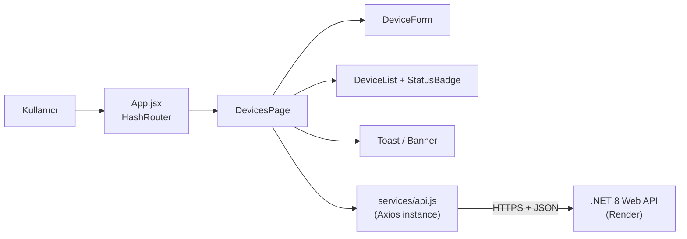

# Device Tracker (Frontend)

Cihaz ve sensör okumalarını listeleyen, ekleyen ve silen React + Vite istemcisi. GitHub Pages üzerinde yayınlanır ve Render'daki .NET 8 Web API ile haberleşir.

## Canlı Bağlantılar

| | Adres |
|---|---|
| Frontend | https://mmervekayaa.github.io/device-tracker-frontend/ |
| Backend API | https://device-tracker-backend-kuu5.onrender.com/api/devices |
| Swagger UI | https://device-tracker-backend-kuu5.onrender.com/swagger |
| Backend deposu | https://github.com/mmervekayaa/device-tracker-backend |

## Mimari



### Proje yapısı

```
src/
├── components/     # DeviceForm, DeviceList, StatusBadge, Spinner, Toast
├── pages/          # DevicesPage (ana sayfa), NotFoundPage
├── services/       # api.js – Axios instance, URL normalizasyonu, hata yönetimi
├── styles/         # index.css (tema değişkenleri), App.css (bileşen ve mobil düzen)
├── App.jsx         # HashRouter ve sayfa iskeleti
└── main.jsx
```

## Özellikler

- Cihaz listesi: ad, kategori, durum (renkli Aktif/Pasif etiketi), ölçüm değeri, son güncelleme
- Cihaz ekleme formu: boş alan ve **negatif değer** kontrolü (istemci tarafında, sunucuya gitmeden)
- Silme (onay penceresiyle)
- Yükleme göstergeleri (spinner), işlem sırasında devre dışı kalan butonlar
- Başarı/hata için toast bildirimleri, liste alınamazsa "Tekrar dene" butonlu hata banner'ı
- Backend'in 400/404/500 yanıtları ve ağ hataları kullanıcı dostu mesajlara çevrilir
- Mobil uyumlu düzen (tablo dar ekranda yatay kaydırılır)
- `HashRouter` sayesinde GitHub Pages'te sayfa yenilemede 404 oluşmaz

## Ortam Değişkenleri

| Değişken | Açıklama |
|---|---|
| `VITE_API_URL` | Backend'in kök adresi, ör. `http://localhost:5109`. `/api` son eki servis katmanında eklenir; sonda `/` veya `/api` yazılsa da adres normalize edilir. Tanımlı değilse `http://localhost:5109` kullanılır. |

## Yerel Geliştirme

Gereksinim: Node.js 20+

```bash
git clone https://github.com/mmervekayaa/device-tracker-frontend.git
cd device-tracker-frontend
cp .env.example .env      # gerekirse VITE_API_URL'i düzenleyin
npm install
npm run dev               # http://localhost:5173/device-tracker-frontend/
```

Diğer komutlar:

```bash
npm run lint      # oxlint ile statik kod analizi
npm run build     # üretim derlemesi (dist/)
npm run preview   # derlenmiş çıktıyı yerelde sunar
```

Backend'i yerelde çalıştırmak için [backend deposundaki](https://github.com/mmervekayaa/device-tracker-backend) adımları izleyin. Backend CORS ayarı `http://localhost:5173` kökenine izin verir.

## CI/CD

`.github/workflows/deploy.yml`: `main` dalına her push'ta Ubuntu runner üzerinde Node.js kurulur, bağımlılıklar yüklenir, lint ve `npm run build` çalışır; çıktı GitHub'ın resmi Pages action'ları (`configure-pages`, `upload-pages-artifact`, `deploy-pages`) ile yayınlanır. Canlı backend adresi derleme sırasında `VITE_API_URL` ile verilir.

> Depo ayarlarında **Settings → Pages → Build and deployment → Source** değeri **GitHub Actions** olmalıdır.

## Önemli Notlar

- **Render cold start:** Backend 15 dakika istek almazsa uykuya geçer; ilk istek 30-60 saniye sürebilir. Bu sırada sayfada yükleniyor göstergesi görünür.
- **Veri kalıcılığı yok:** Backend verileri bellekte tutar; yeniden başladığında başlangıç verisine döner.

## Teknolojiler

- React 18, Vite
- React Router (HashRouter)
- Axios
- oxlint
- GitHub Actions, GitHub Pages
